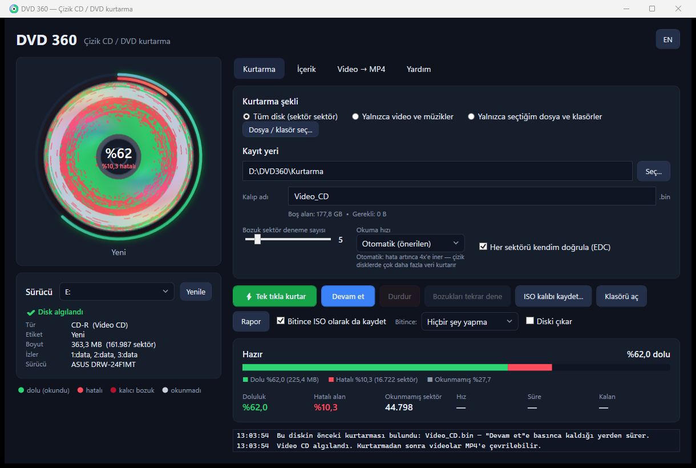
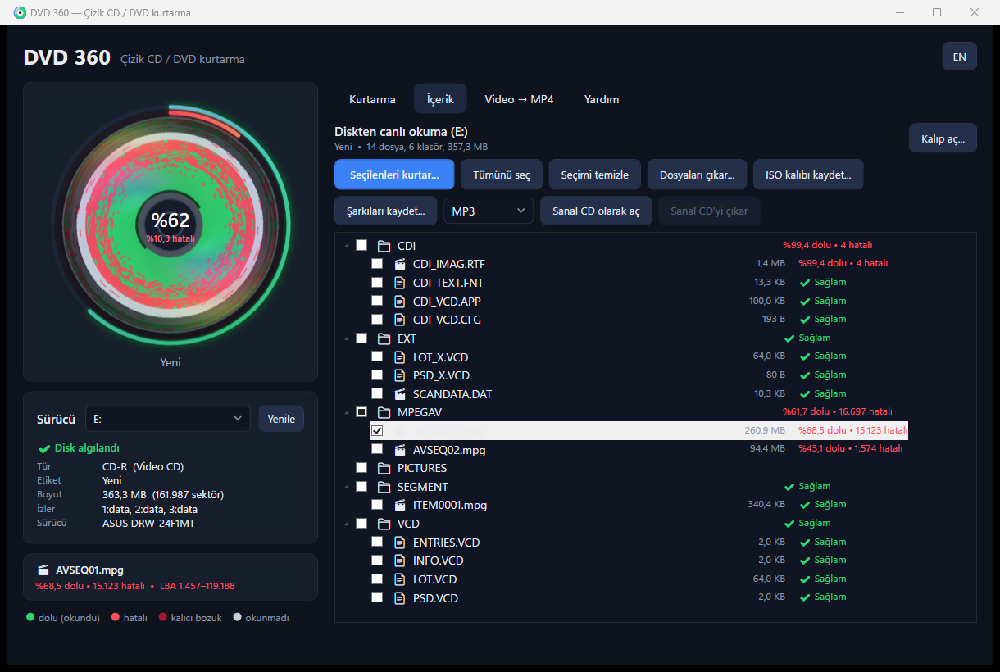
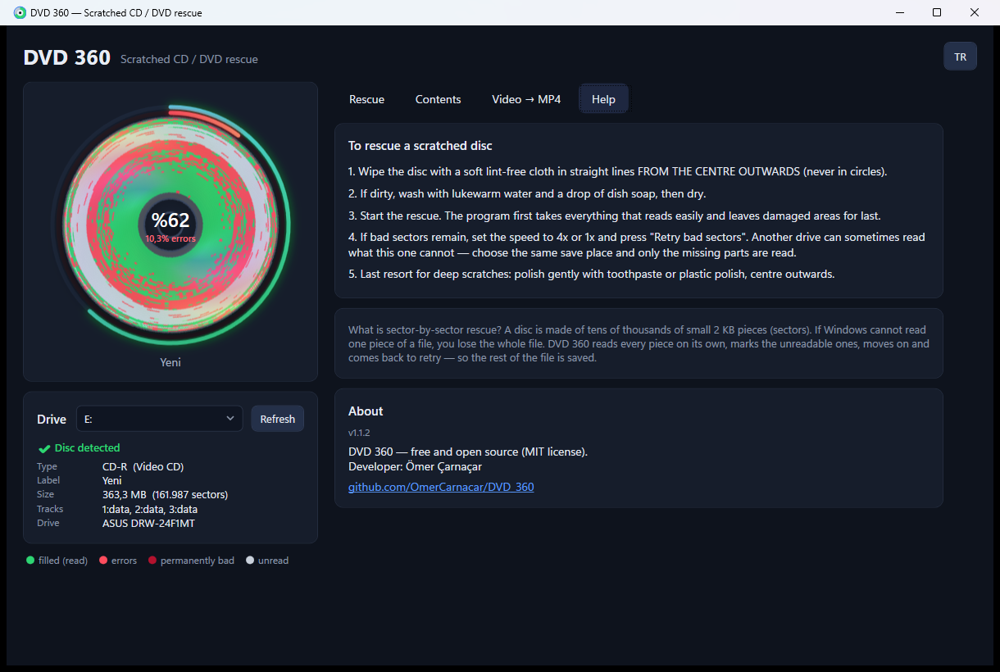
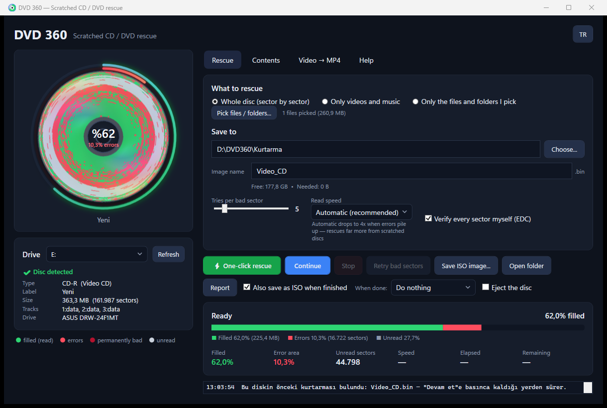

# DVD 360 — Çizik CD / DVD Kurtarma

**Ücretsiz ve açık kaynak** Windows uygulaması. Çizilmiş, eskimiş, Windows'un "okunamıyor" dediği CD, DVD ve Blu-ray disklerinden **sektör sektör** veri kurtarır. Kurtarılan diski ISO kalıbı yapar ve sanal CD olarak açar. Eski Video CD / DVD görüntülerini de iyileştirilmiş **MP4**'e çevirir.

*Free, open-source Windows app that rescues data from scratched CDs/DVDs sector by sector, saves ISO images, mounts them as a virtual drive and converts old video to upscaled MP4. [English below](#english).*

[](https://github.com/OmerCarnacar/DVD_360/releases/latest)
[](LICENSE)



| İçerik: her dosyanın durumu, seçilen dosya diskte parlıyor | Yardım ve İngilizce arayüz |
|---|---|
|  |  |

---

## Neden?

Windows bir dosyanın tek bir sektörünü bile okuyamazsa dosyanın tamamını kopyalamaz. Çoğu zaman dakikalarca donar ve sonunda hata verir. DVD 360 diske **doğrudan sürücü komutlarıyla (SCSI/MMC)** erişir:

1. **Hızlı geçiş:** Kolay okunan her yer önce alınır. Çizik bölgeler atlanır, sona bırakılır.
2. **Atlanan bölgeler:** İkinci geçişte okunur.
3. **Sektör sektör:** Okunamayan her sektör tek tek, defalarca denenir.
4. **Tekrar dene:** Diski temizledikten veya başka bir sürücüye taktıktan sonra **yalnızca eksik sektörler** okunur. Okunmuş hiçbir şey tekrar okunmaz.

Her okumanın bir zaman aşımı vardır, bu yüzden program hiç donmaz. Her CD sektörü kendi **EDC sağlama toplamıyla** doğrulanır. Böylece sürücünün sessizce bozuk veri verdiği durumlar da (özellikle Video CD'lerde) yakalanır.

## Özellikler

- 💿 **Otomatik algılama:** Disk takıldığı anda tanınır, türü ve içeriği gösterilir.
- 🔄 **Canlı disk animasyonu:** Disk döner, okunan bölgeler gerçek konumlarında yeşille dolar, hatalı yerler kırmızı işaretlenir. **Doluluk** (yeşil halka) ve **hatalı alan** (kırmızı halka) ayrı ayrı gösterilir.
- 🧩 **Sektör sektör kurtarma:** İlerleme kaydedilir, istediğiniz zaman durdurup devam edebilirsiniz.
- 📀 **ISO kalıbı:** Veri CD'leri birebir kopyalanır. Video CD'lerde tüm dosyalar eksiksiz olarak yeni bir ISO'ya yerleştirilir. Ayrıca ham `.bin/.cue` kopya da tutulur.
- 🖥️ **Sanal CD:** Tek tıkla Windows'a sürücü olarak bağlanır ve Gezgin'de açılır.
- 📂 **İçerik görüntüleme:** Dosya ağacında her dosyanın sağlam mı, kaç sektörünün bozuk olduğu gösterilir. Çift tıklayınca dosya açılır.
- 🎬 **Video → MP4:** Taramalı görüntü düzeltilir (bwdif), parazit azaltılır, görüntü 720p / 1080p'ye büyütülüp keskinleştirilir, H.264 veya H.265 olarak kaydedilir. Bozuk sektörlü videolar da işlenir.
- ⚡ **Tek tıkla kurtarma:** Diski okur, dosyaları çıkarır, videoları MP4'e, şarkıları MP3/FLAC'a çevirir, rapor yazar; her şey tek klasörde.
- 🎵 **Video ve müzik odaklı kurtarma:** Yalnızca video dosyalarının ve ses parçalarının sektörleri okunur.
- 🎶 **Ses CD'leri:** Her şarkı ayrı **MP3, FLAC veya WAV** olarak kaydedilir. Videoların yalnızca sesi de MP3 olarak alınabilir.
- 🧮 **Çoklu okuma oylaması:** Video CD sektörleri birkaç kez okunur, her bayt için çoğunluk seçilir; sağlama toplamı tutarsa sektör onarılmış sayılır. Tekrar denemelerden önce sürücünün önbelleği atlatılır.
- 📊 **Hasar raporu:** Disk haritası ve dosya başına doluluk/hata içeren HTML rapor.
- 📼 **DVD-Video:** `VTS_xx_1..n.VOB` parçaları tek bir videoya birleştirilip MP4'e çevrilir.
- ⏻ **Uzun işler için:** Bitince Windows bildirimi, diski çıkarma, uyku / hazırda bekletme / bilgisayarı kapatma (iptal edilebilir geri sayımla), görev çubuğunda ilerleme.
- 🖱️ **Sürükle-bırak:** `.iso`/`.bin` kalıbı veya video dosyası pencereye bırakılabilir.
- 🔔 **Güncelleme bildirimi:** Yeni sürüm çıkınca uygulama haber verir.
- 💾 **Taşınabilir mod:** Exe'nin yanına `portable.txt` koyarsanız ayarlar ve FFmpeg exe'nin yanında tutulur (USB bellek için).
- 🌐 Türkçe / English arayüz.
- 🔓 Yönetici izni gerekmez.

## İndirme

[**Releases**](https://github.com/OmerCarnacar/DVD_360/releases) sayfasından `DVD360.exe` dosyasını indirip çalıştırın. Kurulum gerekmez.

> Video çevirme için FFmpeg gerekir. Uygulama ilk kullanımda tek tıkla indirir.

## Kullanım

1. Diski takın. Program diski kendiliğinden algılar.
2. **Kayıt yeri**'ni seçin ve **Kurtarmayı başlat**'a basın.
3. Bitince **İçerik** sekmesinden dosyaları çıkarın, **ISO kalıbı kaydet**'e basın veya **Sanal CD olarak aç**ın.
4. Video CD / DVD ise **Video → MP4** sekmesinden videoları çevirin.

Bozuk sektör kalırsa:
- Diski yumuşak bir bezle **ortadan dışa doğru** silin.
- Okuma hızını **4x** veya **1x** yapın.
- **Bozukları tekrar dene**'ye basın. Başka bir sürücü de deneyebilirsiniz; aynı kayıt yerini seçmeniz yeter.

## Komut satırı

```
dvd360 info E
dvd360 rescue E D:\Kurtarma\disk.bin --retries 8 --speed 4
dvd360 rescue E D:\Kurtarma\disk.bin --retry-bad
dvd360 list D:\Kurtarma\disk.bin
dvd360 extract D:\Kurtarma\disk.bin D:\Kurtarma\dosyalar
dvd360 iso D:\Kurtarma\disk.bin D:\Kurtarma\disk.iso
dvd360 mp4 AVSEQ01.mpg video.mp4 --quality 1080
dvd360 mp3 AVSEQ01.mpg ses.mp3
dvd360 audio D:\Kurtarma\muzik.bin D:\Kurtarma\sarkilar
dvd360 report D:\Kurtarma\disk.bin D:\Kurtarma\rapor.html
dvd360 eject E
```

## Derleme

.NET 11 SDK gerekir.

```
dotnet test tests/Dvd360.Tests
dotnet publish src/Dvd360.App -c Release -r win-x64 --self-contained -p:PublishSingleFile=true
```

Proje yapısı:

| Klasör | İçerik |
|---|---|
| `src/Dvd360.Core` | Kurtarma motoru, SCSI erişimi, sektör haritası, ISO 9660/Joliet okuyucu ve yazıcı, video dönüştürücü |
| `src/Dvd360.App` | WPF masaüstü uygulaması |
| `src/Dvd360.Cli` | Komut satırı aracı |
| `tests/Dvd360.Tests` | Birim testleri (sahte hasarlı disk ile) |

## Lisans

[MIT](LICENSE) © 2026 Ömer Çarnaçar. Ücretsiz kullanın, değiştirin, dağıtın.

FFmpeg ayrı bir programdır ve kendi lisansıyla (GPL) indirilir; DVD 360'a gömülü değildir.

---

## English



DVD 360 reads scratched discs **sector by sector** through SCSI pass-through, with a per-command timeout and its own EDC verification. It uses a ddrescue-style multi-pass strategy and keeps a resumable map. It can then:

- save an ISO (exact for data discs, rebuilt with full files for Video CDs) plus a raw `.bin/.cue`;
- mount the ISO as a virtual drive;
- browse the contents with per-file damage reports;
- convert VCD/DVD video to deinterlaced, denoised, upscaled MP4.

Download `DVD360.exe` from Releases. No install and no admin rights needed. MIT licensed.
